# OOP2026
## HomeWork1
-------------
```java
public class hw1 {
    public static void main(String[] args) {
        for (int i = 1; i <= 4; i++) {
            for (int j = 1; j <= i; j++) {
                System.out.print("#");
            }
            for (int j = 1; j <= 7 - i; j++) {
                System.out.print(" ");
            }

            for (int j = 1; j < i; j++) {
                System.out.print(" ");
            }
            for (int j = 1; j <= 5 - i; j++) {
                System.out.print("#");
            }
            for (int j = 1; j <= 3; j++) {
                System.out.print(" ");
            }

            for (int j = 1; j <= i; j++) {
                System.out.print("#");
            }
            for (int j = 1; j <= 7 - i; j++) {
                System.out.print(" ");
            }

            for (int j = 1; j < i; j++) {
                System.out.print(" ");
            }
            for (int j = 1; j <= 5 - i; j++) {
                System.out.print("#");
            }
            System.out.println();
        }
    }
}
```
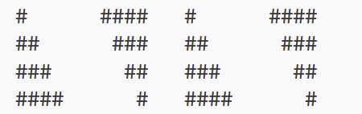

## HomeWork2
-------------
```java
public class hw2 {
    public static void main(String[] args) {
        int first = 1;
        int second = 1;

        for (int i = 1; i <= 20; i++) {
            System.out.print(first);

            if (i < 20) {
                System.out.print(" ");
            }

            int next = first + second;
            first = second;
            second = next;
        }

        System.out.println();
    }
}
```
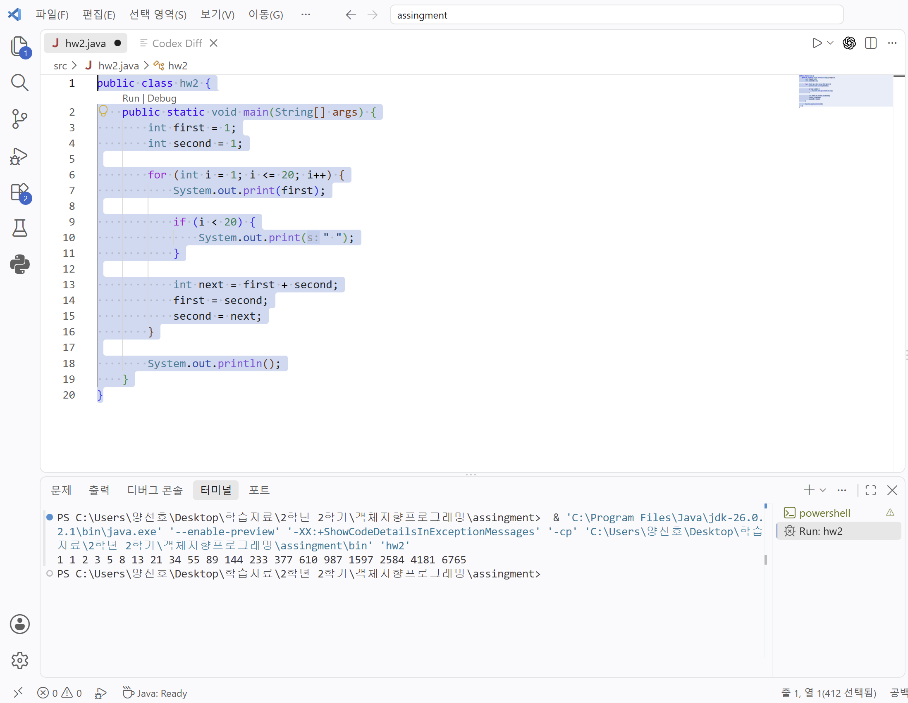

## HomeWork3
-------------
```java
public class hw3 {
    public static void main(String[] args) {
        int first = 1;
        int second = 1;

        for (int i = 1; i < 20; i++) {
            if (i >= 2) {
                double ratio = (double) second / first;
                System.out.println(second + "/" + first + "=" + ratio);
            }

            int next = first + second;
            first = second;
            second = next;
        }
    }
}
```
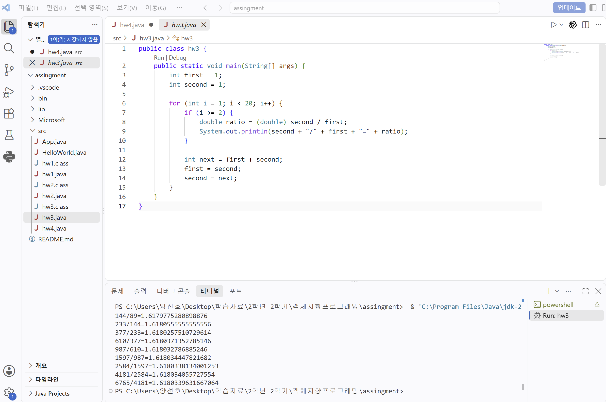

## HomeWork4
-------------
```java
public class hw4 {
    public static void main(String[] args) {
        for (int i = 1; i <= 9; i++) {
            for (int j = 1; j <= 9; j++) {
                System.out.print(j + "*" + i + "=" + (j * i));
                if (j < 9) {
                    System.out.print("\t");
                }
            }   
            System.out.println();
        }
    }
}
```
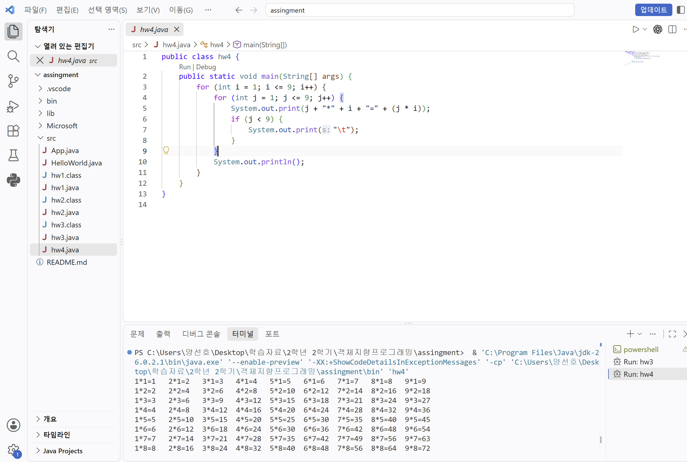

## HomeWork5
-------------
```java
public class hw5 {
    public static void main(String[] args) {
        double gregoryPi = 0.0;
        int sign = 1;

        for (int k = 0; k < 1000000; k++) {
            gregoryPi += sign * 4.0 / (2 * k + 1);
            sign = -sign;
        }

        double madhavaSum = 0.0;

        for (int k = 0; k < 40; k++) {
            madhavaSum += Math.pow(-1.0 / 3.0, k) / (2 * k + 1);
        }

        double madhavaPi = Math.sqrt(12.0) * madhavaSum;

        System.out.println("Gregory: " + gregoryPi);
        System.out.println("Madhava: " + madhavaPi);
    }
}
```
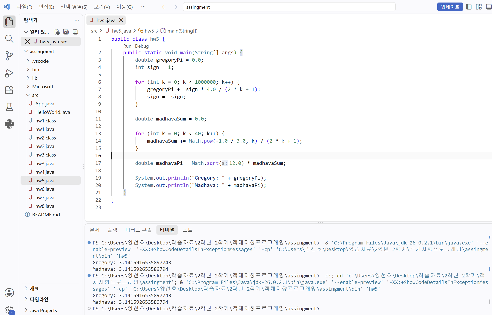

## HomeWork6
-------------
```java
public class hw6 {
    public static void main(String[] args) {
        int binomial[][] = new int[7][7];

        for (int n = 0; n < binomial.length; n++) {
            for (int k = 0; k <= n; k++) {
                if (k == 0 || k == n) {
                    binomial[n][k] = 1;
                } else {
                    binomial[n][k] = binomial[n - 1][k - 1]
                            + binomial[n - 1][k];
                }

                System.out.print(binomial[n][k]);
                if (k < n) {
                    System.out.print(" ");
                }
            }
            System.out.println();
        }
    }
}
```
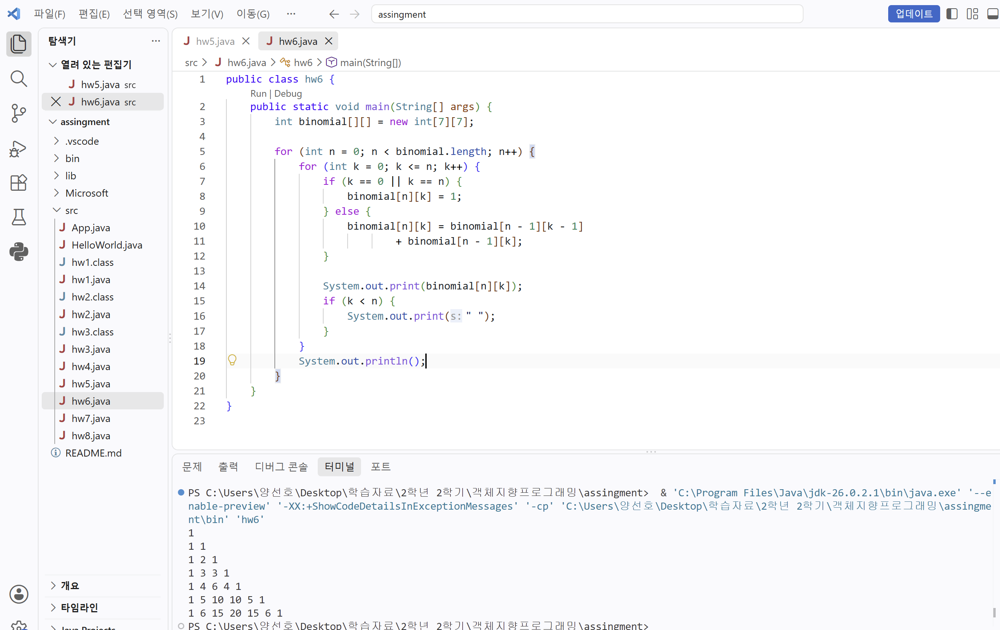

## HomeWork7
-------------
```java
public class hw7 {
    public static void main(String[] args) {
        int data[] = new int[20];

        for (int i = 0; i < 20; i++) {
            data[i] = (int) (Math.random() * 100);
        }

        for (int i = 0; i < data.length - 1; i++) {
            int minIndex = i;

            for (int j = i + 1; j < data.length; j++) {
                if (data[j] < data[minIndex]) {
                    minIndex = j;
                }
            }

            int temp = data[i];
            data[i] = data[minIndex];
            data[minIndex] = temp;
        }

        for (int i = 0; i < 20; i++) {
            System.out.println(data[i]);
        }
    }
}
```
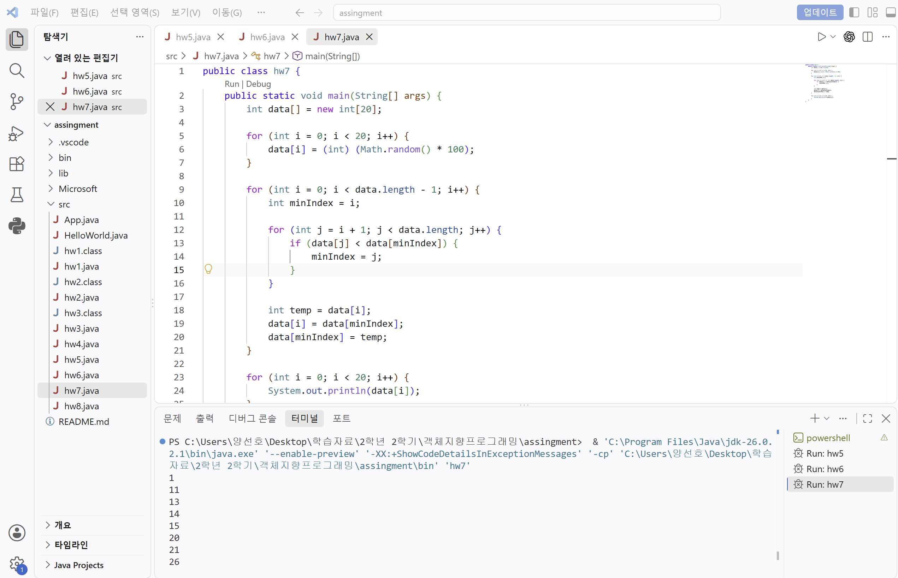

## HomeWork8
-------------
```java
public class hw8 {
    public static void main(String[] args) {
        int score[][] = new int[30][4];

        for (int i = 0; i < score.length; i++) {
            int sum = 0;
            System.out.print(i + 1);

            for (int j = 0; j < score[i].length; j++) {
                score[i][j] = (int) (Math.random() * 101);
                sum += score[i][j];
                System.out.print("\t" + score[i][j]);
            }

            System.out.println("\t" + sum);
        }
    }
}
```
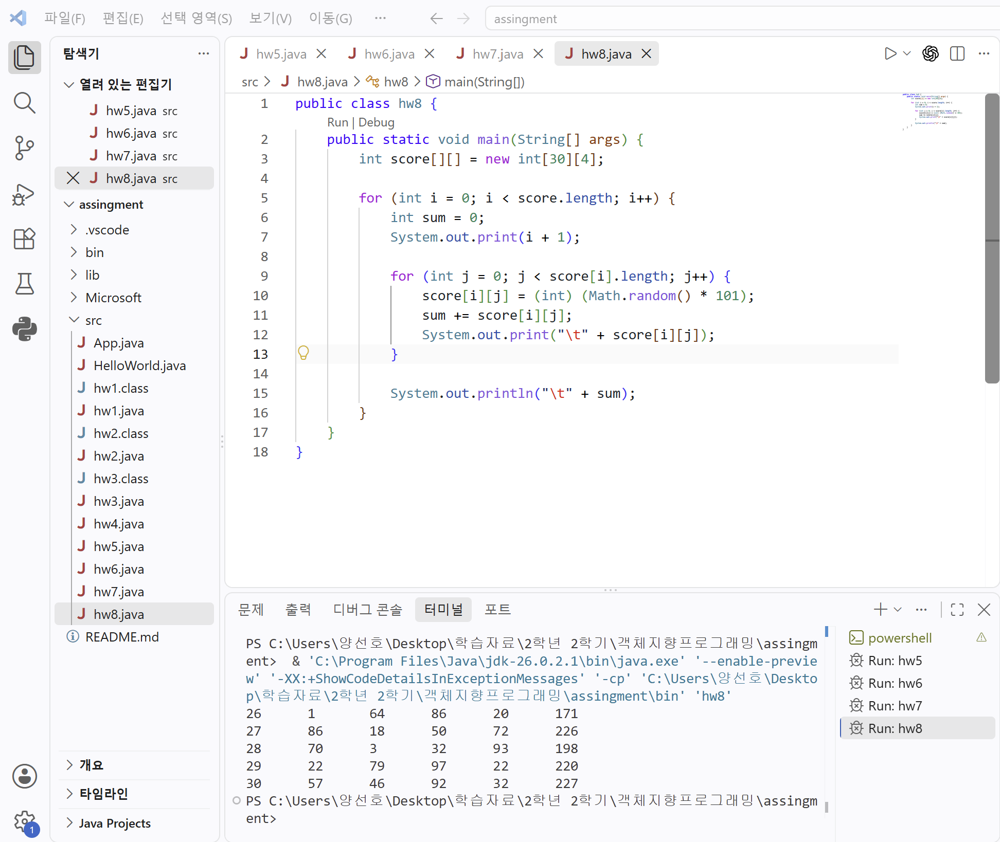

## HomeWork9
-------------
```java
public class hw9 {
    public static void main(String[] args) {
        int[] decimalIntegers = {257, 128};
        String[] binaryIntegers = {"101010", "1110"};
        double[] decimalNumbers = {
            1.75, 1.625, 1.5625, 1.875,
            13.875, 45.875, 1.9, 1.1
        };

        System.out.println("[10진법 -> 2진법]");
        for (int number : decimalIntegers) {
            System.out.println("(" + number + ")_10 = ("
                    + decimalIntegerToBinary(number) + ")_2");
        }

        System.out.println("\n[2진법 -> 10진법]");
        for (String number : binaryIntegers) {
            System.out.println("(" + number + ")_2 = ("
                    + binaryToDecimal(number) + ")_10");
        }

        System.out.println("\n[10진 소수 -> 2진 소수]");
        for (double number : decimalNumbers) {
            System.out.println("(" + number + ")_10 = ("
                    + decimalToBinary(number, 16) + ")_2");
        }
    }

    static String decimalIntegerToBinary(int number) {
        if (number == 0) {
            return "0";
        }

        String binary = "";
        while (number > 0) {
            binary = (number % 2) + binary;
            number /= 2;
        }
        return binary;
    }

    static int binaryToDecimal(String binary) {
        int decimal = 0;
        for (int i = 0; i < binary.length(); i++) {
            decimal = decimal * 2 + (binary.charAt(i) - '0');
        }
        return decimal;
    }

    static String decimalToBinary(double number, int maxFractionDigits) {
        int integerPart = (int) number;
        double fractionPart = number - integerPart;
        StringBuilder result = new StringBuilder(
                decimalIntegerToBinary(integerPart));

        if (fractionPart == 0) {
            return result.toString();
        }

        result.append('.');
        int count = 0;

        while (fractionPart > 1.0e-12 && count < maxFractionDigits) {
            fractionPart *= 2;
            int bit = (int) fractionPart;
            result.append(bit);
            fractionPart -= bit;
            count++;
        }

        if (fractionPart > 1.0e-12) {
            result.append("...");
        }

        return result.toString();
    }
}
```
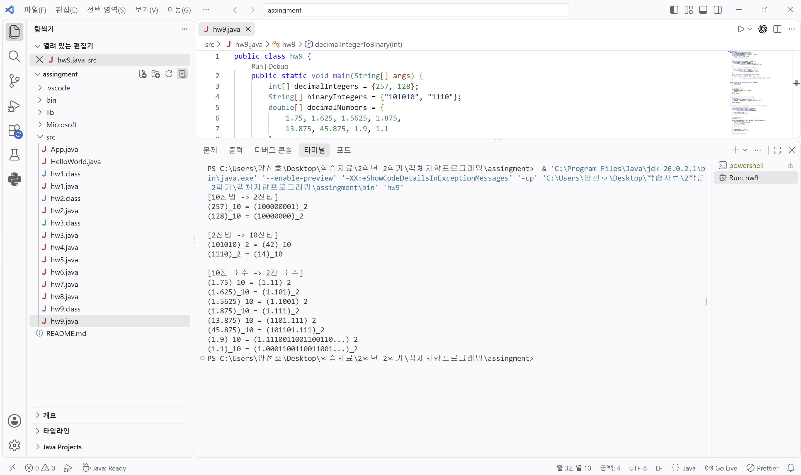

## HomeWork10
--------------
```java
public class hw10 {
    public static void main(String[] args) {
        if (args.length != 4) {
            System.out.println(
                    "Usage: hw10 array_count max_value bin_size display_scale");
            return;
        }

        int arrayCount = Integer.parseInt(args[0]);
        int maxValue = Integer.parseInt(args[1]);
        int binSize = Integer.parseInt(args[2]);
        int displayScale = Integer.parseInt(args[3]);

        if (arrayCount <= 0 || maxValue <= 0
                || binSize <= 0 || displayScale <= 0) {
            System.out.println("All arguments must be positive integers.");
            return;
        }

        int[] data = new int[arrayCount];
        int binCount = (maxValue + binSize - 1) / binSize;
        int[] histogram = new int[binCount];

        for (int i = 0; i < data.length; i++) {
            data[i] = (int) (Math.random() * maxValue);
            histogram[data[i] / binSize]++;
        }

        for (int i = 0; i < histogram.length; i++) {
            int start = i * binSize;
            int end = Math.min(start + binSize - 1, maxValue - 1);

            System.out.print(start + "~" + end + "\t");

            int barLength = histogram[i] / displayScale;
            for (int j = 0; j < barLength; j++) {
                System.out.print("#");
            }
            System.out.println();
        }
    }
}
```
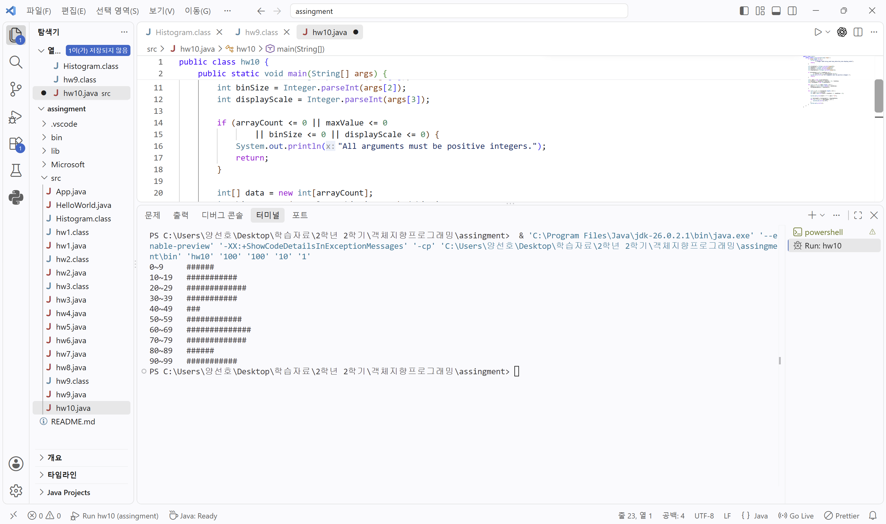

## HomeWork11
-------------
```java
public class hw11 {
    public static void main(String[] args){
        int data[] = new int[100];
        int n = data.length;
        double sum = 0.0;
        double product = 1.0;
        double reciprocalSum = 0.0;

        System.out.print("mean");
        for (int i = 0; i < n; i++) {
            data[i] = (int) (Math.random() * 100) + 1;
            sum += data[i];
            product *= data[i];
            reciprocalSum += 1.0 / data[i];
            System.out.print(" " + data[i]);
        }
        System.out.println();

        double arithmeticMean = sum / n;
        double geometricMean = Math.pow(product, 1.0 / n);
        double harmonicMean = n / reciprocalSum;

        for (int i = 0; i < n - 1; i++) {
            int minIndex = i;
            for (int j = i + 1; j < n; j++) {
                if (data[j] < data[minIndex]) {
                    minIndex = j;
                }
            }
            int temp = data[i];
            data[i] = data[minIndex];
            data[minIndex] = temp;
        }

        double median;
        if (n % 2 == 0) {
            median = (data[n / 2 - 1] + data[n / 2]) / 2.0;
        } else {
            median = data[n / 2];
        }

        System.out.println("arithmetic mean = " + arithmeticMean);
        System.out.println("geometric mean = " + geometricMean);
        System.out.println("harmonic mean = " + harmonicMean);
        System.out.println("median = " + median);
    }
}
```
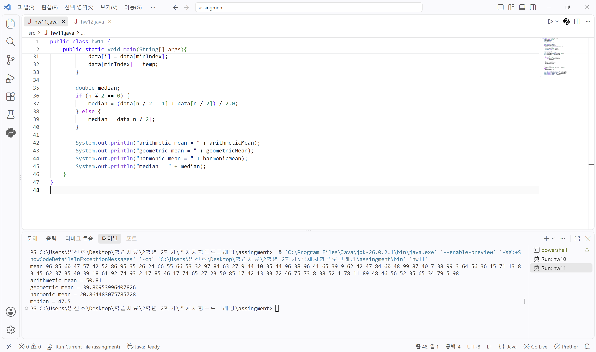

## Homework12
-------------
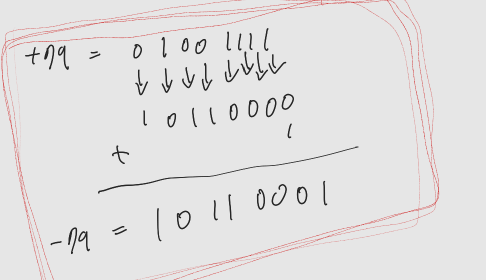

## HomeWork13
-------------
```java
import java.util.Scanner;

public class hw13 {
    public static void main(String[] args) {
        Scanner scanner = new Scanner(System.in);

        while (true) {
            String inputString = scanner.nextLine();
            System.out.println(inputString);

            String[] arrOfStr = inputString.split(" ");
            for (String a : arrOfStr)
                System.out.println(a);

            if (arrOfStr.length == 3 && arrOfStr[1].equals("+")) {
                System.out.println(
                    Integer.parseInt(arrOfStr[0])
                    + Integer.parseInt(arrOfStr[2])
                );
            }
        }
    }
}
```
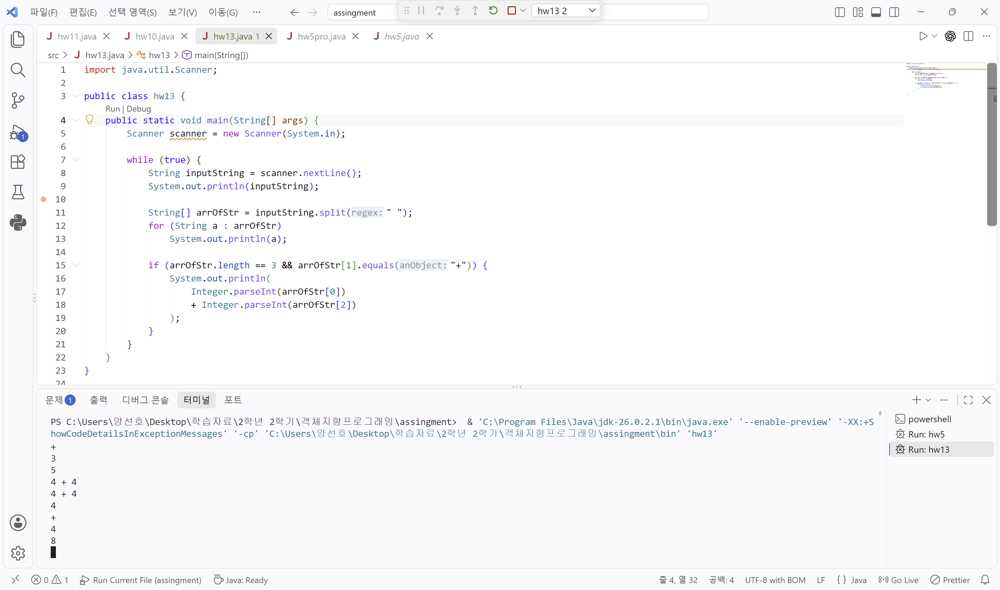

##HomeWork14
------------
```java
// Numbers.java 파일
public class Numbers {
    int num[];
	Numbers(int num[]) {
		if (num == null || num.length == 0)
			throw new IllegalArgumentException("Data must not be empty.");
		this.num = num;
	}

	double getTotal() {
		double sum=0;
		for(int i=0; i<num.length; i++) sum+=num[i];
		return sum;
	}

	double getArithmaticMean() {
		return getTotal()/num.length;
	}

	double getHarmonicMean() {
		double sum = 0;
		for (int i = 0; i < num.length; i++) {
			if (num[i] <= 0) return Double.NaN;
			sum += 1.0 / num[i];
		}
		return num.length / sum;
	}

	double getGeometricMean() {

		double sum = 0;
		boolean hasZero = false;
		for (int i = 0; i < num.length; i++) {
			if (num[i] < 0) return Double.NaN;
			if (num[i] == 0) hasZero = true;
			else sum += Math.log(num[i]);
		}
		if (hasZero) return 0;
		return Math.exp(sum / num.length);
	}

	double getMedian() {
		sorting();
		int middle = num.length / 2;
		if (num.length % 2 == 1) return num[middle];
		return ((double) num[middle - 1] + num[middle]) / 2.0;
	}

	void sorting() {
		java.util.Arrays.sort(num);
	}

	void drawHistogram(int start, int end, int binCount) {
		if (start >= end || binCount <= 0)
			throw new IllegalArgumentException("Invalid histogram range or bin count.");
		int[] frequency = new int[binCount];
		double width = ((double) end - start) / binCount;

		for (int i = 0; i < num.length; i++) {
			if (num[i] >= start && num[i] < end) {
				int index = (int) ((num[i] - (double) start) / width);
				frequency[Math.min(index, binCount - 1)]++;
			}
		}
		for (int i = 0; i < binCount; i++) {
			System.out.printf("[%6.2f, %6.2f) : %3d ",
					start + i * width, start + (i + 1) * width, frequency[i]);
			for (int j = 0; j < frequency[i]; j++) System.out.print("*");
			System.out.println();
		}
	}

	void display() {
		System.out.printf("%3d :", num.length);		
		for(int i=0; i<num.length; i++) 
            System.out.printf("%3d ", num[i]);
		System.out.println();
	}
}

//NumbersTest.java 파일
public class NumbersTest {
    public static void main(String[] args) {
		int size=100;
		int data[]=new int[size];

		for(int i=0; i<size; i++) 
            data[i]=(int)(Math.random()*100);

		Numbers obj = new Numbers(data);
		obj.display();
        
		System.out.printf("Arithmetic Mean : %5.2f\n", obj.getArithmaticMean());
		System.out.printf("Geometric Mean : %5.2f\n", obj.getGeometricMean());		
		obj.drawHistogram(0,100,10);
	}

}
```
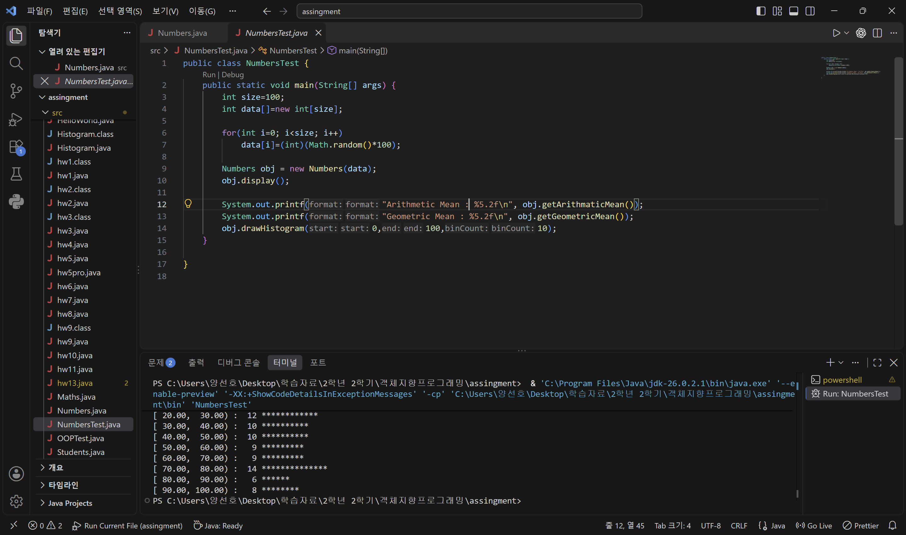

##HomeWork15
-------------
```java
#C2048
public class C2048 {
    int value[][] = new int[4][4];

    C2048() {
        init();
    }

    void init() {
        value = new int[4][4];
        update();
        update();
    }

    void update() {
        int count = 0;
        for (int i = 0; i < 4; i++)
            for (int j = 0; j < 4; j++)
                if (value[i][j] == 0) count++;
        if (count == 0) return;

        int target = (int) (Math.random() * count);
        for (int i = 0; i < 4; i++) {
            for (int j = 0; j < 4; j++) {
                if (value[i][j] == 0) {
                    if (target == 0) {
                        value[i][j] = ((int) (Math.random() * 2) + 1) * 2;
                        return;
                    }
                    target--;
                }
            }
        }
    }

    void left() {
        boolean changed = false;
        for (int i = 0; i < 4; i++) {
            int[] line = new int[4];
            int count = 0;
            for (int j = 0; j < 4; j++) {
                if (value[i][j] != 0) line[count++] = value[i][j];
            }

            int[] result = new int[4];
            int index = 0;
            for (int j = 0; j < count; j++) {
                if (j + 1 < count && line[j] == line[j + 1]) {
                    result[index++] = line[j] * 2;
                    j++;
                } else {
                    result[index++] = line[j];
                }
            }

            for (int j = 0; j < 4; j++) {
                if (value[i][j] != result[j]) changed = true;
                value[i][j] = result[j];
            }
        }
        if (changed) update();
        display();
    }

    void right() {
        boolean changed = false;
        for (int i = 0; i < 4; i++) {
            int[] line = new int[4];
            int count = 0;

            for (int j = 0; j < 4; j++) {
                if (value[i][3 - j] != 0) line[count++] = value[i][3 - j];
            }

            int[] result = new int[4];
            int index = 0;
            for (int j = 0; j < count; j++) {
                if (j + 1 < count && line[j] == line[j + 1]) {
                    result[index++] = line[j] * 2;
                    j++;
                } else {
                    result[index++] = line[j];
                }
            }

            for (int j = 0; j < 4; j++) {
                if (value[i][3 - j] != result[j]) changed = true;
                value[i][3 - j] = result[j];
            }
        }
        if (changed) update();
        display();
    }

    void up() {
        boolean changed = false;
        for (int i = 0; i < 4; i++) {
            int[] line = new int[4];
            int count = 0;
            for (int j = 0; j < 4; j++) {
                if (value[j][i] != 0) line[count++] = value[j][i];
            }

            int[] result = new int[4];
            int index = 0;
            for (int j = 0; j < count; j++) {
                if (j + 1 < count && line[j] == line[j + 1]) {
                    result[index++] = line[j] * 2;
                    j++;
                } else {
                    result[index++] = line[j];
                }
            }

            for (int j = 0; j < 4; j++) {
                if (value[j][i] != result[j]) changed = true;
                value[j][i] = result[j];
            }
        }
        if (changed) update();
        display();
    }

    void down() {
        boolean changed = false;
        for (int i = 0; i < 4; i++) {
            int[] line = new int[4];
            int count = 0;
            for (int j = 0; j < 4; j++) {
                if (value[3 - j][i] != 0) line[count++] = value[3 - j][i];
            }

            int[] result = new int[4];
            int index = 0;
            for (int j = 0; j < count; j++) {
                if (j + 1 < count && line[j] == line[j + 1]) {
                    result[index++] = line[j] * 2;
                    j++;
                } else {
                    result[index++] = line[j];
                }
            }

            for (int j = 0; j < 4; j++) {
                if (value[3 - j][i] != result[j]) changed = true;
                value[3 - j][i] = result[j];
            }
        }
        if (changed) update();
        display();
    }

    void display() {
        for (int i = 0; i < 4; i++) {
            for (int j = 0; j < 4; j++)
                System.out.printf("%5d ", value[i][j]);
            System.out.println();
        }
        System.out.println();
    }
}

#C2048Player
import java.awt.*;
import java.awt.event.ActionEvent;
import javax.swing.*;

public class C2048Player extends JPanel {
    private final C2048 obj = new C2048();
    private final JLabel[][] tiles = new JLabel[4][4];
    private final JLabel message = new JLabel();

    C2048Player() {
        setLayout(new BorderLayout(12, 12));
        setBackground(new Color(0xFAF8EF));
        setBorder(BorderFactory.createEmptyBorder(20, 20, 20, 20));

        JLabel title = new JLabel("2048");
        title.setFont(new Font("SansSerif", Font.BOLD, 40));
        add(title, BorderLayout.NORTH);

        JPanel board = new JPanel(new GridLayout(4, 4, 10, 10));
        board.setBackground(new Color(0xBBADA0));
        board.setBorder(BorderFactory.createEmptyBorder(10, 10, 10, 10));
        board.setPreferredSize(new Dimension(440, 440));
        for (int i = 0; i < 4; i++) {
            for (int j = 0; j < 4; j++) {
                tiles[i][j] = new JLabel("", SwingConstants.CENTER);
                tiles[i][j].setOpaque(true);
                board.add(tiles[i][j]);
            }
        }
        add(board, BorderLayout.CENTER);

        JPanel footer = new JPanel(new BorderLayout(8, 8));
        footer.setOpaque(false);
        message.setFont(new Font("Malgun Gothic", Font.PLAIN, 13));
        footer.add(message, BorderLayout.NORTH);
        JButton restart = new JButton("다시 시작 (R)");
        restart.setFont(new Font("Malgun Gothic", Font.PLAIN, 14));
        restart.setFocusable(false);
        restart.addActionListener(e -> { obj.init(); refresh(); });
        footer.add(restart, BorderLayout.SOUTH);
        add(footer, BorderLayout.SOUTH);

        bind("LEFT", obj::left);
        bind("A", obj::left);
        bind("RIGHT", obj::right);
        bind("D", obj::right);
        bind("UP", obj::up);
        bind("W", obj::up);
        bind("DOWN", obj::down);
        bind("S", obj::down);
        bind("R", obj::init);
        refresh();
    }

    private void bind(String key, Runnable action) {
        getInputMap(WHEN_IN_FOCUSED_WINDOW).put(KeyStroke.getKeyStroke(key), key);
        getActionMap().put(key, new AbstractAction() {
            public void actionPerformed(ActionEvent e) {
                action.run();
                refresh();
            }
        });
    }

    private void refresh() {
        boolean canMove = false;
        boolean won = false;
        int[] colors = {0xCDC1B4, 0xEEE4DA, 0xEDE0C8, 0xF2B179,
                0xF59563, 0xF67C5F, 0xF65E3B, 0xEDCF72,
                0xEDCC61, 0xEDC850, 0xEDC53F, 0xEDC22E};
        for (int i = 0; i < 4; i++) {
            for (int j = 0; j < 4; j++) {
                int n = obj.value[i][j];
                int colorIndex = n == 0 ? 0 : Integer.numberOfTrailingZeros(n);
                JLabel tile = tiles[i][j];
                tile.setText(n == 0 ? "" : String.valueOf(n));
                tile.setBackground(new Color(colorIndex < colors.length ? colors[colorIndex] : 0x3C3A32));
                tile.setForeground(new Color(n <= 4 ? 0x776E65 : 0xFFFFFF));
                tile.setFont(new Font("SansSerif", Font.BOLD, n < 1024 ? 36 : n < 16384 ? 28 : 20));
                if (n >= 2048) won = true;
                if (n == 0 || (i < 3 && n == obj.value[i + 1][j])
                        || (j < 3 && n == obj.value[i][j + 1])) canMove = true;
            }
        }
        if (!canMove) message.setText("게임 종료! 다시 시작하려면 R을 누르세요.");
        else if (won) message.setText("2048 달성! 계속 플레이할 수 있습니다.");
        else message.setText("방향키 또는 W/A/S/D로 이동하세요. (Enter 필요 없음)");
    }

    public static void main(String[] args) {
        SwingUtilities.invokeLater(() -> {
            JFrame frame = new JFrame("2048");
            frame.setDefaultCloseOperation(JFrame.EXIT_ON_CLOSE);
            frame.setContentPane(new C2048Player());
            frame.pack();
            frame.setResizable(false);
            frame.setLocationRelativeTo(null);
            frame.setVisible(true);
        });
    }
}
```
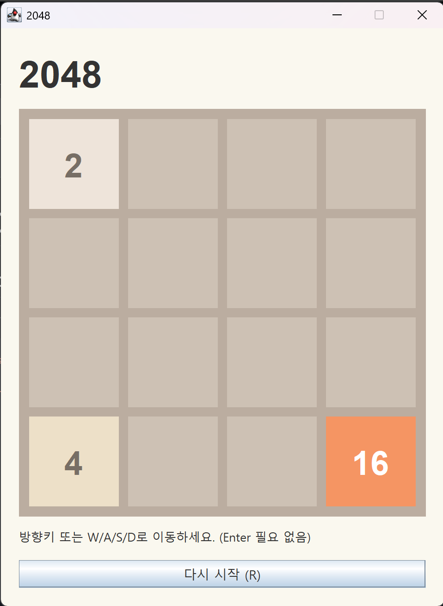
